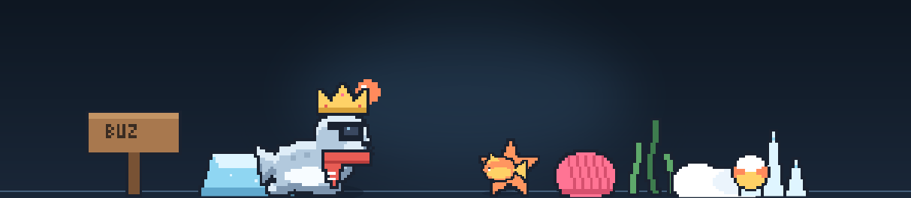

# 🦭 Fok — Masaüstü Pet

Windows masaüstünde yaşayan, pixel art bir fok. Şeffaf pencere, click-through, fizik, ihtiyaç sistemi, mağaza ve mini oyunlar.



## İndirme

Hazır sürüm: **[Fok 0.2.2](https://github.com/SadSeal5/seal-pet/releases/latest)**

- `Fok Setup 0.2.2.exe` — NSIS installer (masaüstü + başlangıç menüsü kısayolu)
- `Fok 0.2.2.exe` — portable, kurulum gerektirmez

İmzasız olduğu için SmartScreen "bilinmeyen yayıncı" uyarısı verebilir: **Daha fazla bilgi → Yine de çalıştır**.

## Çalıştırma

```bash
npm install
npm start
```

İlk çalıştırmada Electron ikilisi iner (~100 MB), sonrası hızlı.

```bash
npm test     # pet/animatör davranış testleri (Node test runner)
```

## Kurulum (installer)

```bash
npm run dist     # dist/Fok Setup 0.2.2.exe + portable exe
npm run pack     # yalnızca paketlenmiş klasör (dist/win-unpacked)
```

NSIS installer kurulum klasörünü seçtirir, masaüstü ve başlangıç menüsü kısayolu oluşturur.
Paketlenmiş sürümde tray menüsündeki **Başlangıçta aç** seçeneği de etkinleşir.

## Kontroller

| Etkileşim | Sonuç |
|---|---|
| Sol tık (fokun üstüne) | Sevme — kalpler, mutluluk +9, 2 saniyede bir +1 🐟 |
| Sürükle | Havada asılı kalır; bırakınca düşer, fırlatınca yuvarlanır |
| Çift tık | Kutlama spini |
| Sağ tık | Menü: Besle / Sev / Yıka / Oyna / Arkadaş çağır / Uyut / Mağaza / Oyunlar / Durum / Ayarlar / Gizle / Çıkış |
| Topu sürükle | Fizikli top; fok peşinden koşar, burnunda dengeler |
| Balığı sürükle | Fok yaklaşıp yer |
| Süsü sürükle | Süsü masaüstünde istediğin yere taşı (konum kaydedilir) |
| Esc | Açık paneli / mini oyunu kapat |

Masaüstünün geri kalanı normal çalışır: pencere yalnızca imleç fokun/topun/süsün/menünün üstündeyken fareyi yakalar.
İmleç konumu ana süreçten yoklanır (33 ms), böylece `forward:true` fare olaylarına bağımlı değildir.

## Arkadaşlar

Ara sıra masaüstüne bir arkadaş gelir: 🐧 penguen, 🦦 su samuru, 🐦 martı, 🦀 yengeç, 🐟 balık.
Kenardan girer, fokun yanına yürür, yaklaşık 1 dakika takılır (fok yakınındaysa daha uzun), arada foka doğru zıplar, sonra gider.
Aynı anda en fazla 2 arkadaş olur. Sağ tık menüsünden "🐧 Arkadaş çağır" ile hemen çağırabilirsiniz.

## Mağaza ve balık parası

Balık parası (🐟) kazanma yolları:

- Foku sevmek: +1 (2 saniyede bir)
- Balık yedirmek: +2 (besleme bekleme süresi vardır)
- Mini oyun skoru: skor kadar

Mağaza sağ tık menüsünden veya tray'den açılır. İki bölüm vardır:

**Aksesuarlar** — kafa (parti şapkası, taç, Noel şapkası, kulaklık), yüz (güneş gözlüğü, göz bandı),
boyun (atkı, papyon), sırt (sırt çantası). Satın alınca otomatik takılır; aynı slottan tek parça takılır.
Fok sola döndüğünde aksesuarlar da onunla birlikte aynalanır.

**Süsler** — buz kütlesi, yosun, denizyıldızı, parti flaması, kar yığını, deniz kabuğu, buz saçağı, isim tabelası.
Satın alınca masaüstüne konur, sürükleyerek taşınabilir, mağazadan "Kaldır" ile kaldırılabilir.
Parti flaması ekranın üstünde gerili bir flama olarak çizilir.

Tüm alımlar, takılı aksesuarlar, süs konumları ve ayarlar `save.json` içinde saklanır.
Kayıt önce geçici dosyaya yazılıp atomik olarak taşınır; bozuk kayıt durumunda `save.json.bak` yedeği kullanılır.

## Bakım

Temizlik azaldıkça fok mutsuzlaşır. Sağ tık menüsünden veya tray'den **🛁 Yıka** ile temizliği
100'e çıkarabilirsin (20 saniye bekleme süresi vardır).

## İhtiyaçlar

| İhtiyaç | Uyanıkken azalma | Yaklaşık süre |
|---|---|---|
| Tokluk | 1 puan / 25 sn | ~42 dk |
| Mutluluk | 1 puan / 45 sn | ~76 dk |
| Enerji | 1 puan / 20 sn | ~33 dk |
| Temizlik | 1 puan / 2 dk | ~3,5 saat |

Uyurken enerji dolar, tokluk daha yavaş azalır. Uygulama kapalıyken geçen süre en fazla
1 saat için hafifçe düşülür. Temizlik 25'in altına inince fok ekstra mutsuzlaşır.

## Mini oyunlar

| Oyun | Nasıl oynanır |
|---|---|
| 🐟 Balık yakala | Yerden zıplayan balıklara 20 saniye boyunca tıkla |
| 🫧 Köpük patlat | Aşağıdan yükselen köpükleri patlat; üst üste vurdukça kombo yazar |

Oyun sırasında pencere tamamen fare yakalar, bitince eski click-through hâline döner.
Skor balık parasına ve XP'ye dönüşür, mutluluk artar. Esc ile erken bitirilebilir.

## Ortam farkındalığı

- Kullanıcı 10 dakikadır boştaysa fok da uyur
- Gece 22:00–07:00 arası daha sık esner / uyur
- Pilde çalışırken huzursuzlanır (annoyed)
- Tray menüsünden "Rahatsız Etme" ile gizlenebilir, paketlenmiş sürümde "Başlangıçta aç"

## Sprite üretimi

Tüm kareler kodla üretilir (16 renkli kilitli palet, 48×48, 1px outline):

```bash
python tools/gen_sprites.py    # fok: 23 klip + props + ikonlar
python tools/gen_friends.py    # arkadaşlar: 5 tür × 2 klip (32×32)
python tools/gen_shop.py       # 9 aksesuar + 8 süs (48×48) + shop.json
```

Çıktılar:
- `assets/seal/*.png` — 23 klip, yatay şerit
- `assets/seal/atlas.json` — klip meta verisi
- `assets/friends/*.png` + `friends.json` — arkadaş şeritleri
- `assets/accessories/*.png`, `assets/decor/*.png` + `shop.json` — mağaza
- `assets/icon.png`, `assets/icon.ico`, `assets/tray.png`
- `tools/preview.png` — tüm kliplerin kontak sayfası
- `tools/friends_preview.png` — arkadaşların kontak sayfası
- `tools/accessories_preview.png`, `tools/decor_preview.png` — mağaza önizlemeleri
- `tools/zoom.png`, `tools/head.png` — yakın inceleme

Paleti değiştirmek için `tools/gen_sprites.py` içindeki `PAL` sözlüğünü düzenleyip yeniden üretin.
Aksesuar/süs fiyatları `tools/gen_shop.py` içindeki `SHOP` sözlüğündedir.

## Mimari

```
electron/main.js       pencere, tray, IPC, kayıt, imleç/ortam yoklaması
electron/preload.js    güvenli köprü
src/main.js            oyun döngüsü, giriş, hit-test, click-through, mağaza akışı
src/engine/animator.js sprite şerit animatörü
src/engine/audio.js    WebAudio 8-bit efektler
src/pet/pet.js         fizik, animasyon, ihtiyaçlar, ekonomi, aksesuar çizimi, kayıt
src/pet/ai.js          utility tabanlı davranış seçici
src/world/toys.js      top / balık fiziği
src/world/friends.js   ziyaretçi arkadaşlar
src/world/decor.js     süs yerleşimi, sürükleme, kayıt
src/world/minigame.js  balık yakala / köpük patlat
src/ui/ui.js           menü, durum, ayarlar, mağaza, toast
tests/pet.test.mjs     animatör, hedef sınırları, kayıt doğrulama, ekonomi testleri
```

Kayıt: `%APPDATA%/seal-pet/save.json`

## Ayarlar

- **Boyut** 2×–5× (varsayılan 3× = 144 px)
- **Hep üstte**
- **Ses**
- **Fareyi takip et** — fok ara sıra imlece doğru yürür

Ayarlar kayda yazılır ve uygulama yeniden açıldığında geri yüklenir.

## Yol haritası

- [x] M0 iskelet, şeffaf pencere, tray
- [x] M1 sprite pipeline + animatör
- [x] M2 fizik, sürükle/fırlat, click-through
- [x] M3 ihtiyaçlar, kayıt, menü
- [x] M4 top, balık, XP
- [x] M5a arkadaşlar (penguen, su samuru, martı, yengeç, balık)
- [x] M5b ortam farkındalığı (boşta uyuma, gece, pil)
- [x] M5c süsler, mini oyunlar
- [x] M6 aksesuarlar, mağaza, installer
